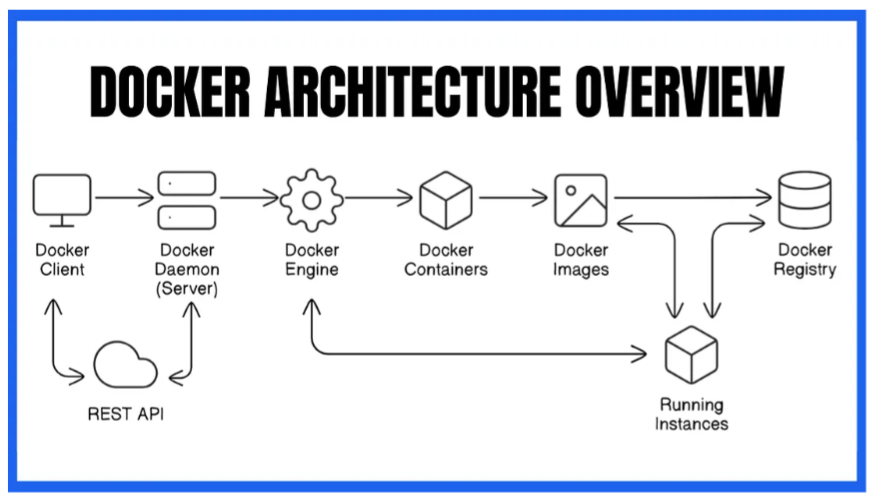

# Docker And Kubernetes

# 1.1 What is Docker
- Docker is an open platform for developing, shipping, and running applications by building containers. 
- With Docker, you can separate your applications from your infrastructure and treat your infrastructure like a managed application.
- Docker helps you ship code faster, test faster, deploy faster, and **shorten the cycle** between **writing code** and **running code**.

Docker does this by combining kernel containerization features with workflows and tooling that helps you manage and deploy your applications.

Docker containers can be directly used in `Kubernetes`, which allows them to be run in the Kubernetes Engine with ease. After learning the essentials of Docker, you will have the skillset to start developing Kubernetes and containerized applications.

 

# 1.1  Why Docker?
- Two + people working on same big project may work on different versions and OS
- Example : 
  - Developer A :  On `WindowsOS` - With different versions of software
  - Developer B : On `MacOS` -With different versions of software
 - Both users have different CLI arguments, and need synchronization.
- Thus we need Docker

 

## What we need?
1. First undersand what is docker?
2. What is docker image?

##  What we Do?
- We bundle our application on `Machine A` and sent it to `Machine B`, similar to containers shipped via big ships.
- We dont actually share setup container as a docker container, we share a docker image

---

 

# Docker Architecture
 1. The Docker client contacted the [Docker daemon](https://github.com/Yash-Bandal/Docker-Essentials/blob/main/Notes/Terms.md#1-docker-daemon).
 2. The Docker daemon pulled the "hello-world" image from the [Docker Hub](https://github.com/Yash-Bandal/Docker-Essentials/blob/main/Notes/Terms.md#2-docker-hub).     
    (amd64)
 3. The Docker daemon created a new container from that image which runs the  
    executable that produces the output you are currently reading.
 4. The Docker daemon streamed that output to the Docker client, which sent it
    to your terminal.

 

 

---

# Properties
1. Portable
2. Light weight (Docker container/ image size is < less than Actual Virtual Machine)
3. Allow 2+ versions of a software in a build environment, 1 Docker , 1+containers holding its own virtual environment with different versions (eg, Container 1- Nodev16, Container 2-Nodev20)

