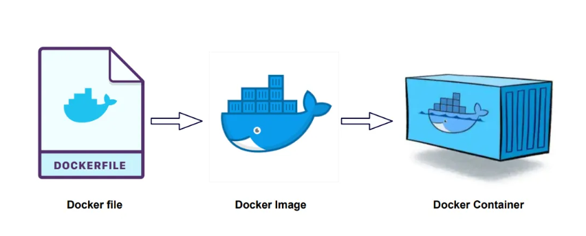

# 2. Docker Images & Containers
---
> Docker Image = A Lego instruction manual

> Docker Container = The Lego model you build from that manual
---

<div align="center">
   
</div>


## 2.1 Docker Image
A Docker image is a lightweight, standalone, and executable package that includes everything needed to run a piece of software, including the code, runtime, system tools, libraries, and settings.

## 2.2 Docker Container
A Docker container is a lightweight, portable, and isolated environment that runs your application along with all of its dependencies.


Think of an image as a template or a snapshot of a container.
- File that contains instructions to build a container .
- Its similar to relation between `class` and `object`
  - Like 1 class (blueprint.)-> used to make 1+ instances
  - 1 Docker image (static blueprint) -> 1+ container

  <br>

|   Feature | Docker Image | Docker Container |
 |----------------|-------------------------------------|------------------|
 | Definition | Blueprint to build a container | Actual running instance of the image | 
 | Memory Usage | No memory usage unless instantiated | Uses system resources when running | 
 | Use Case | Shared across machines | Created and run locally per image |

  <br>

  - Classes dont hold memory within, instances do. SImilarly our containers use system resources, not the image
  - Thus we share this Docker image 


  <br>
  <br>
  
# Example walkthrough

## Running a Practical Docker Example: Ubuntu Container
Let’s now walk through a practical Docker example.

We’re going to:
  - Use our **macOS system** as the host.
  - Run an **Ubuntu container** inside it using Docker.
  - Access the **Ubuntu terminal** and interact with it.

  
```bash
docker  run  -it  ubuntu
```


### Breakdown:
-  `run`: Tells Docker to create and run a container.
-  `-it`: Stands for **interactive terminal**. It gives us access to the container's shell.
-  `ubuntu`: The name of the Docker image we want to use (in this case, Ubuntu).

  


### What Happens When You Run This Command?

1. Docker first **checks if the Ubuntu image is available locally**.
2. If not, it **pulls it from Docker Hub**.
3. Docker then:
    -  **Creates a container** from the image.
    -  **Starts the container**.
    -  **Opens a terminal** session inside Ubuntu.

4. You can verify this using **Docker Desktop**, which visually shows:
    - A new container running.
    - The base image (`ubuntu`).
    - The container's unique ID.

  
<br>


###  Inside the Ubuntu Container
You’re now inside a completely **isolated Ubuntu environment**, separated from your OS system.

You can:
- Create files and folders using standard Linux commands.
- Modify or delete anything inside the container.
- Exit anytime — and **nothing on your macOS** will be affected.


<br>


This proves that **Docker containers provide clean, isolated environments** for running apps, tools, or even full operating systems.


This Ubuntu container is just the beginning. Later, we’ll run containers for **Node.js**, **MongoDB**, and other technologies — each isolated in its own space.

---

# Docker Hub
##  What is Docker Hub?
**Docker Hub** is a **cloud-based registry service** where you can:
1.  **Store** Docker images
2.  **Share** them with others
3.  **Download (pull)** images built by others    
4.  **Build and automate** your own image pipelines

Think of it like **GitHub, but for multipe Docker images**.


<br>

---

<br>

# 3 Installation
[Youtube](https://www.youtube.com/watch?v=ZyBBv1JmnWQ)


<br>

---

<br>


