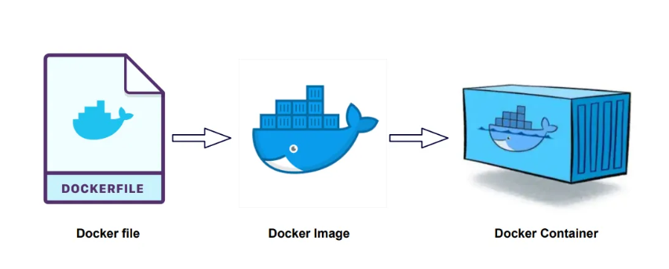
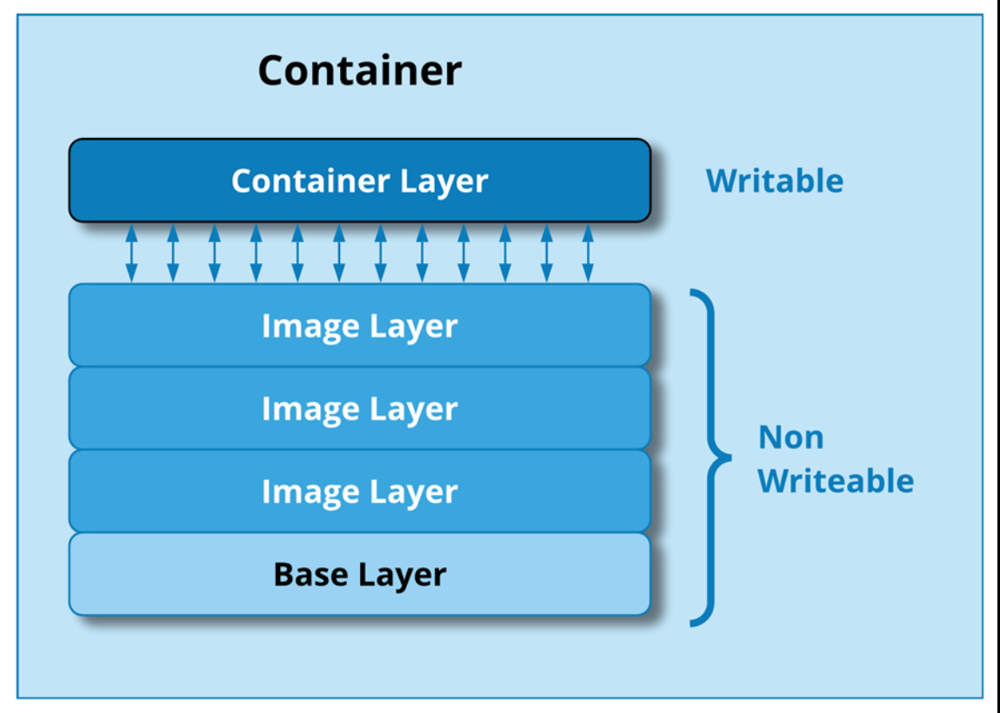
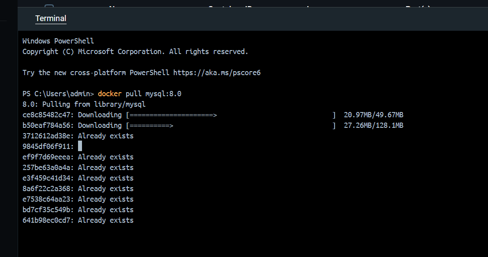
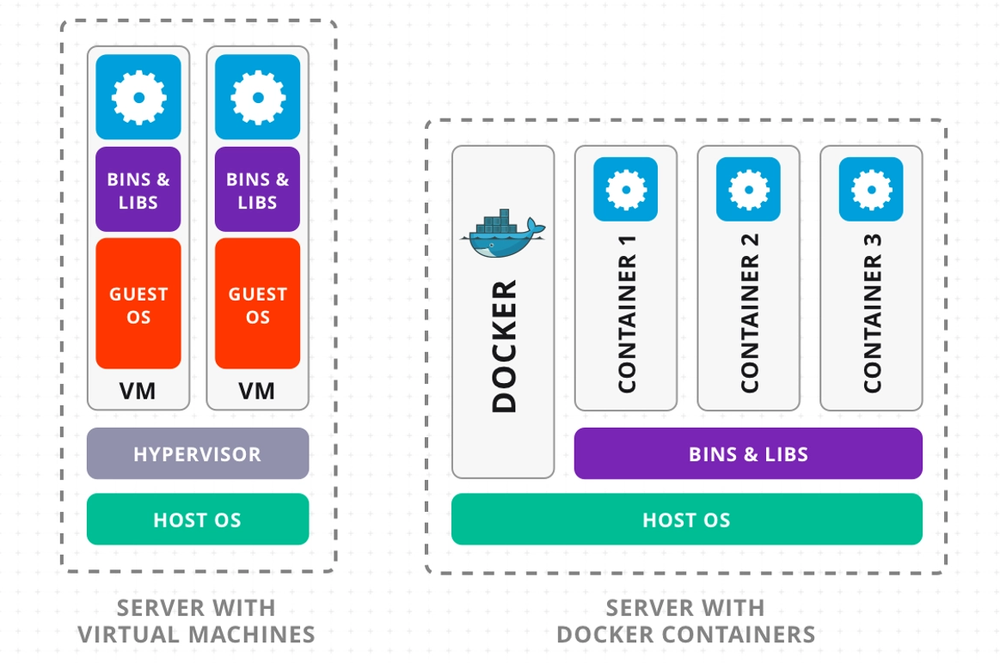
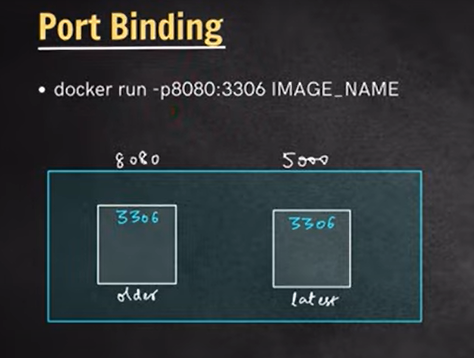
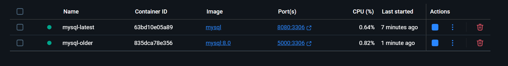

# 2. Docker Images & Containers
---
> Docker Image = A Lego instruction manual

> Docker Container = The Lego model you build from that manual
---

<div align="center">
   
</div>


## 2.1 Docker Image
A Docker image is a lightweight, standalone, and executable package that includes everything needed to run a piece of software, including the code, runtime, system tools, libraries, and settings.

> **Q. From Where is this image created?**\
> You write a file called `Dockerfile` in your project.
>
> Example `Dockerfile`
> ```
> FROM python:3.12
>
> WORKDIR /app
>
> COPY requirements.txt .
>
> RUN pip install -r requirements.txt
>
> COPY . .
>
> CMD ["python", "app.py"]
> ```

> [!Note]
> Dockerfile is not the image. It is the instruction manual used to create the image.
>
> A Docker image consists of multiple read-only layers stacked together.

<br>

## 2.2 Docker Container
A Docker container is a lightweight, portable, and isolated environment that runs your application along with all of its dependencies. <br>
Think of an image as a template or a snapshot of a container.
- File that contains instructions to build a container .
- Its similar to relation between `class` and `object`
  - Like 1 class (blueprint.)-> used to make 1+ instances
  - 1 Docker image (static blueprint) -> 1+ container

> A container is essentially a group of processes running with isolation provided by the operating system.

  <br>

 |   Feature | Docker Image | Docker Container |
 |----------------|-------------------------------------|------------------|
 | Definition | Blueprint to build a container | Actual running instance of the image | 
 | Memory Usage | No memory usage unless instantiated | Uses system resources when running | 
 | Use Case | Shared across machines | Created and run locally per image |

  <br>

  - Classes dont hold memory within, instances do. SImilarly our containers use system resources, not the image
  - Thus we share this Docker image 


  <br>
  <br>
  
# Example walkthrough

## Running a Practical Docker Example: Ubuntu Container
Let’s now walk through a practical Docker example.

We’re going to:
  - Use our **macOS system** as the host.
  - Run an **Ubuntu container** inside it using Docker.
  - Access the **Ubuntu terminal** and interact with it.

  
```bash
docker  run  -it  ubuntu
```


### Breakdown:
-  `run`: Tells Docker to create and run a container.
-  `-it`: Stands for **interactive terminal**. It gives us access to the container's shell.
-  `ubuntu`: The name of the Docker image we want to use (in this case, Ubuntu).

  


### What Happens When You Run This Command?

1. Docker first **checks if the Ubuntu image is available locally**.
2. If not, it **pulls it from Docker Hub**.
3. Docker then:
    -  **Creates a container** from the image.
    -  **Starts the container**.
    -  **Opens a terminal** session inside Ubuntu.

4. You can verify this using **Docker Desktop**, which visually shows:
    - A new container running.
    - The base image (`ubuntu`).
    - The container's unique ID.

  
<br>


###  Inside the Ubuntu Container
You’re now inside a completely **isolated Ubuntu environment**, separated from your OS system.

You can:
- Create files and folders using standard Linux commands.
- Modify or delete anything inside the container.
- Exit anytime — and **nothing on your macOS** will be affected.


<br>


This proves that **Docker containers provide clean, isolated environments** for running apps, tools, or even full operating systems.


This Ubuntu container is just the beginning. Later, we’ll run containers for **Node.js**, **MongoDB**, and other technologies — each isolated in its own space.


<br>

---

<br>

# 3 Installation
[Youtube](https://www.youtube.com/watch?v=ZyBBv1JmnWQ)


<br>

---

<br>

# 4 Docker Commands

[Docker Commands](https://github.com/Yash-Bandal/Docker-Essentials/blob/main/Notes/02_PART-2.md)

<br>

---

<br>


## Key Concepts:
### 12. Layers in DockerImages

<br>

[Docker Images](https://github.com/Yash-Bandal/Docker-Essentials/blob/main/Notes/Terms.md#3-docker-image-layers)

Think of a **Docker image like a layered cake**:

- 5. Final Layer → Define startup command


-   4. Fourth Layer → Set environment variables
-  3. Third Layer → Copy your application code
-  2. Second Layer → Install Node.js   

- 1.  Base Layer → The operating system (e.g., Ubuntu)

###   Image layers
Each layer in an image contains a set of filesystem changes - additions, deletions, or modifications. Let’s look at a theoretical image:
```
The first layer adds basic commands and a package manager, such as apt.
The second layer installs a Python runtime and pip for dependency management.
The third layer copies in an application’s specific requirements.txt file.
The fourth layer installs that application’s specific dependencies.
The fifth layer copies in the actual source code of the application.
This example might look like:
```
[Reference-Diagram](https://docs.docker.com/get-started/docker-concepts/building-images/understanding-image-layers/)
 
<br>

### Where you see Layers? 
While Downloading/ Pulling Images, different Layers are installed (see the `Downloading...` content)
- If layers alreaady exist (eg. you had a version 8.0 of mysql and now you pull latest mysql image), they are skipped and only required layers are downloaded
  



<br>

---

<br>

# 5 Docker vs VM


1. Docker only virtualizes the `Application Layer`  and uses the `Host OS` of the Users Machine.  
2. Virtual Machine virtualizes the `Application Layer`  as well as `Host OS`. 


| Feature | Docker | Virtual Machine |
| ---------------- | ------------------------- | ----------------------------------- |
| Isolation Method | Shares the host OS kernel | Emulates full OS (including kernel) |
| Size | **Docker container image**: Lightweight (MBs) eg.   `ubuntu`: ~29 MB| **Virtual Machine image** (a full OS): Heavy (GBs) eg. Ubuntu VM: 2–4 GB minimum | 
| Startup Time | Seconds | Minutes |
| Performance | Close to native (due to no overhead) | Slower (due to OS overhead) |
| Portability | Very portable | Less portable |
| Use Case | App-level isolation | System-level isolation |
| Disadvantage |  it has compatibility issues (It was initially buuld for LINUS OS) | It has No compatibility issues (work for all OS)|

<br>
<div align = "center">
   
   <h3>Architectures</h3>
</div>

<br>

---
>Docker was initially built for Linux, and although it now supports Windows and macOS via Docker Desktop, under the hood it still relies on Linux-based containers.
---

Now you may think , how we can run `LINUX KERNEL` on windows or Mac, because we use Docker Desktop :
 - On Windows/macOS, Docker runs a lightweight Hypervisor/ VM in the background.
 - On Linux, Docker works natively (natuarally).
Thus, DOCKER is more compatible with LINUX and most companies Run DOCKER on LINUX. but its compatible for Small Projects on Windows and Mac


<br>

---

<br>


# 6 Port Mapping & Setting Env Variables
- **Port binding** is the process of making a **port inside a Docker container** accessible from your **host machine** (and optionally, the internet).
- Every Docker container has its own internal ports. For example, a MySQL container usually runs on **port 3306** internally. However, this port is **not exposed to your host system by default**.

If you want to access the container’s service (like a database or web server) from your host machine, you need to **map or bind a host port to the container’s port**.

This is called **port binding**.

---
> Note : `Image Ports` are always different (localhost 0.0.0.5000, 0.0.0.8080) , even for different versions (eg. mysql , mysql 8.0) , `Container Ports` inside images are same (Mysql default :3306)
---




<br>
<br>

**1. Installed 2 Images**
```bash
PS C:\Users\admin> docker images
REPOSITORY   TAG       IMAGE ID       CREATED       SIZE
mysql        latest    04768cb63395   7 weeks ago   1.17GB
mysql        8.0       4890b3247d48   7 weeks ago   1.06GB
```

<br>
<br>

**2. Run two containers for each**
 - Image -mysql -> Container -mysql-latest
	```bash
	PS C:\Users\admin> docker run -d  -e MYSQL_ROOT_PASSWORD=secret --name mysql-latest mysql
	4be703d8a5655e507328a5d3f6ae7a9f7a66bfa781d42d9d629f5ec84e9c473c
	```
 
	
- Use Image - mysql:8.0 -> Container - mysql-older
	```bash
	PS C:\Users\admin> docker run -d  -e MYSQL_ROOT_PASSWORD=secret --name  mysql-older  mysql:8.0
  d0d941ef063838e46105c4eae775c3893b22e89d9e71a9bf1be86fa0afb9273a
	```	
	```bash
	PS C:\Users\admin> docker ps -a
	CONTAINER ID  IMAGE      COMMAND                 CREATED          STATUS         PORTS                 NAMES
	d0d941ef0638  mysql:8.0  "docker-entrypoint.s…"  7s ago           Up 5 seconds   3306/tcp, 33060/tcp   mysql-older    
	4be703d8a565  mysql      "docker-entrypoint.s…"  2 minutes ago    Up 2 minutes   3306/tcp, 33060/tcp   mysql-latest   
	```

<br>

3.  Bind with `-p <POST_NUM image localhost> : <PORT_NUM container>`
    -   3.1 Stop and Remove First Containers to create new Binded containers (can also remove from dashboard directly ..click `dustbin` icon ..also can `pause`)
      ```bash
      PS C:\Users\admin> docker stop mysql-latest
      mysql-latest
      PS C:\Users\admin>  docker stop mysql-older
      mysql-older

      PS C:\Users\admin> docker rm mysql-older
      mysql-older
      PS C:\Users\admin> docker rm mysql-latest
      mysql-latest
      ```

      <br>
      
   - 3.2  Now we only have IMAGES and no CONTAINERS
       ```bash
       PS C:\Users\admin> docker ps -a
       CONTAINER ID   IMAGE     COMMAND   CREATED   STATUS    PORTS     NAMES
       ```

       <br>
       
   - 3.3 Bind ports
       - Note that , we cant bind 1 port with 2 containers / 1 containers with 2 ports
           - When you try binding anpther container `mysql-older` with a port `8080` thats aready ported to `mysql-latest` it will get connected, but you cant run it as its already allocated
         eg.
         ```bash
         PS C:\Users\admin> docker run -d -e MYSQL_ROOT_PASSWORD=secret --name mysql-latest -p8080:3306 mysql
         63bd10e05a89769d075e308269708b9cd03a36697910a276f8e5b328b772b3be
         
         PS C:\Users\admin> docker run -d -e MYSQL_ROOT_PASSWORD=secret --name mysql-older -p8080:3306 mysql:8.0
         90f70e8c8f9e3b9c054d462b3cbd1e85061ef2f2c030f41c8eaf3b557cfcd4d7
         ```
         ```
         docker: Error response from daemon: failed to set up container networking: driver failed programming external connectivity on endpoint mysql-old
         er (15c728ddb7af5747083c422473807528e4b32d9e6f8f80ed9b6f7611f9ba876e): Bind for 0.0.0.0:8080 failed: port is already allocated
         ```
         <br>

         ERROR - binding above port 8080 of mysql to mysql 8.0
         - Connecting `mysql-older` with different port is done
         ```bash
         PS C:\Users\admin> docker run -d -e MYSQL_ROOT_PASSWORD=secret --name mysql-older -p5000:3306 mysql:8.0
         835dca78e356373e95c340686ff013ba1a2c36c0ed5aefbd9c5ee9ef90d2b35c
         ```
         ```
         PS C:\Users\admin> docker ps -a
         CONTAINER ID   IMAGE       COMMAND                  CREATED              STATUS         PORTS                               NAMES
         835dca78e356   mysql:8.0   "docker-entrypoint.s…"   About a minute ago   Up 2 minutes   33060/tcp, 0.0.0.0:5000->3306/tcp   mysql-older
         63bd10e05a89   mysql       "docker-entrypoint.s…"   7 minutes ago        Up 8 minutes   33060/tcp, 0.0.0.0:8080->3306/tcp   mysql-latest  
         ```

         


<br>

---

<br>

# 7 Troubleshooting Containers (When Issues Occur)
[Trouble Shoot Commands](https://github.com/Yash-Bandal/Docker-Essentials/blob/main/Notes/Pre-requisites/03_Docker_Commands.md#7-docker-exec-and-logs-trouble-shooting)


<br>

---

<br>
