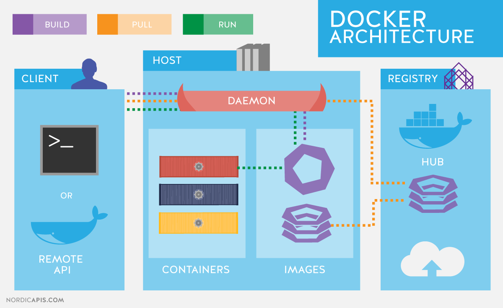

# Docker  :-

## **Table of Contents**

### 1. Fundamentals
1. [Introduction to Docker & Why Docker?](./01_Introduction.md)
2. [Docker Images & Containers](./02_PART-2.md)
3. [Docker Installation & Setup](./02_PART-2.md#3-installation)
4. [Docker Commands](./Pre-requisites/03_Docker_Commands.md)
5. [Docker vs Virtual Machines](./02_PART-2.md#5-docker-vs-vm)
6. [Port Mapping & Environment Variables](./02_PART-2.md#6-port-mapping--setting-env-variables)
7. [Container Troubleshooting](./02_PART-2.md#7-troubleshooting-containers-when-issues-occur)

### 2. Building & Deploying Applications
8. [Building a Node.js Application with Docker](./03_PART-3.md)
9. [Dockerizing a Node.js Application — Dockerfile](./04_PART-4.md)
10. [Docker Compose](./05_PART-5.md)
11. [Publishing Images to Docker Hub](./05_PART-5.md)

### 3. Advanced Docker Concepts
12. [Layers in Docker Images](./02_PART-2.md#12-layers-in-dockerimages)
13. [Docker Volume Mounting & Data Persistence](./06_PART-6.md)
14. [Docker Networking](./07_PART-7.md)

### 4. Reference
15. [Docker Terminology](./Terms.md)
16. [Docker Commands Cheatsheet](./Pre-requisites/03_Docker_Commands.md)
17. [Pre-requisites](./Pre-requisites/README.md)

<br>

```
Docker  Index
1. What is Docker? Why do we need it?
2. Docker Images & Containers
3. Installation of Docker CLI & Desktop
4. Important Docker Commands
5. Docker vs VM
6. Port Mapping & Setting Env Variables
7. Troubleshooting Containers
8. Using Containers to build Node Application
9. Dockerization of Node.js Application (Dockerfile)
10. Docker Compose
    a. Services  
    b. Port Mapping  
    c. Env Variables  
    d. Volumes
11. Publishing to DockerHub
12. Layering in Docker Images
13. Volume Mounting
14. Docker Networking  
    a. Default & Custom Networks  
    b. Using custom network for multi-container apps  
    c. Network drivers: Bridge, Host, Null
```

## 1. **Docker Architecture**



<br>

## 2. **Cheatsheet**
1. [official](https://github.com/wsargent/docker-cheat-sheet#why-docker)
2. [YB-Productions](https://github.com/Yash-Bandal/Docker-Essentials/blob/main/Notes/Pre-requisites/03_Docker_Commands.md)

## References
1. [Docker-Notes](https://github.com/miendinh/docker-notes/blob/master/README.md)
2. [DockerDocs](https://docs.docker.com/get-started/introduction/?_gl=1*1y5ub9v*_gcl_au*MTcxNTAwNjY4Ny4xNzQ4ODM1NDAx*_ga*MTAxODY2NTk4Ny4xNzQ4ODM1NDAy*_ga_XJWPQMJYHQ*czE3NDg4MzU0MDEkbzEkZzEkdDE3NDg4MzU0MDMkajU4JGwwJGgw)
   
